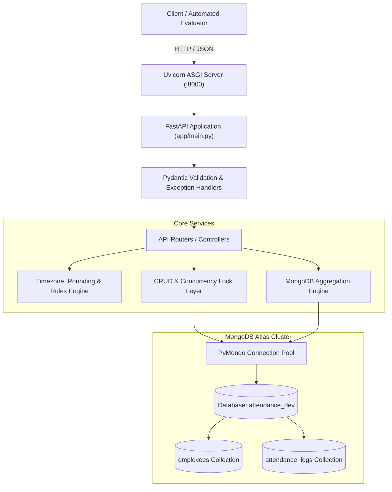

# System Architecture Document

## Project: Employee Attendance & Analytics API
**Framework**: FastAPI | **Driver**: PyMongo | **Database**: MongoDB Atlas 6.0+

---

## 1. High-Level Architecture Topology



The system operates as a stateless single-instance microservice. All state is maintained in MongoDB Atlas.

---

## 2. Collection Schemas & Data Model

### 2.1 Collection: `employees`
Stores master profile and shift rules for each employee. Addressed by `emp_code`.

| Field | Storage Type | API Type | Notes |
|---|---|---|---|
| `_id` | `ObjectId` | *Internal* | Generated by MongoDB; never exposed in API. |
| `emp_code` | `string` | `string` | Unique customer employee code (e.g., `EMP0001`). Indexed unique. |
| `name` | `string` | `string` | Full name of employee. |
| `email` | `string` | `string` | Validated email address. |
| `department` | `string` | `string` | Case-sensitive department name. |
| `shift_start` | `string` | `string` | `HH:MM` (24-hour IST). |
| `shift_end` | `string` | `string` | `HH:MM` (24-hour IST). If $\le \text{shift\_start}$, marks overnight shift. |
| `joined_on` | `string` | `string` | Date string `YYYY-MM-DD`. |
| `created_at` | `BSON Date` | `int64` (ms) | Server timestamp converted to epoch milliseconds at API boundary. |

### 2.2 Collection: `attendance_logs`
Stores attendance records. Addressed by composite key `(emp_code, date)`. At most one document exists per `(emp_code, date)`.

| Field | Storage Type | API Type | Notes |
|---|---|---|---|
| `_id` | `ObjectId` | *Internal* | Never exposed. |
| `emp_code` | `string` | `string` | Foreign reference to `employees.emp_code`. |
| `date` | `string` | `string` | IST calendar date `YYYY-MM-DD` of punch-in (R1). |
| `status` | `string` | `string` | `PRESENT`, `WFH`, `ON_DUTY`, `ABSENT`, or `LEAVE`. |
| `punch_in` | `BSON Date` / `null` | `int64` (ms) / `null` | Stored as BSON UTC datetime. |
| `punch_out` | `BSON Date` / `null` | `int64` (ms) / `null` | Stored as BSON UTC datetime. |
| `work_hours` | `double` / `null` | `float` / `null` | Computed via R4 (Decimal half-up 2 decimals). |
| `late_minutes` | `int` | `int` | Computed via R2 (grace period floor minutes). |
| `overtime_minutes` | `int` | `int` | Computed via R3 ($\ge 30$ mins floor, else 0). |
| `half_day` | `bool` | `bool` | True if rounded `work_hours < 4.50` (R5). |
| `history` | `array[object]` | `array[object]` | Audit log of manual corrections (`PATCH`). |

### 2.3 Nested Document: `history[]`
```json
{
  "at": "2026-07-10T11:00:00Z",
  "by": "HR Admin",
  "reason": "Corrected missed punch-out",
  "changes": {
    "punch_out": { "from": null, "to": "2026-07-10T13:30:00Z" },
    "work_hours": { "from": null, "to": 9.50 }
  }
}
```

---

## 3. Indexing Strategy & Performance Guarantee

At application startup, indexes are built idempotently via `create_indexes()`. These indexes guarantee `IXSCAN` and eliminate `COLLSCAN` during evaluation on 100,000+ documents:

| Target Collection | Index Specification | Properties | Primary Query / Guarantee Served |
|---|---|---|---|
| `employees` | `{"emp_code": 1}` | `unique=True` | Unique duplicate prevention; employee lookups; `$lookup` foreign join. |
| `employees` | `{"department": 1, "joined_on": 1}` | Compound | Filters by department; headcount calculation per date/month. |
| `attendance_logs` | `{"emp_code": 1, "date": 1}` | `unique=True` | Prevents duplicate daily punch-ins; natural key queries; PATCH lookups. |
| `attendance_logs` | `{"date": -1, "emp_code": 1}` | Compound | Backs `GET /attendance` default sorting and pagination. |
| `attendance_logs` | `{"emp_code": 1, "status": 1, "date": 1}` | Compound | Backs employee monthly summary aggregation. |
| `attendance_logs` | `{"status": 1, "date": 1, "late_minutes": 1}` | Compound | Backs late leaderboard aggregation and department metrics. |

---

## 4. Concurrency & Race Condition Architecture

1. **Simultaneous Punch-Ins**:
   - Multiple identical punch-in requests can arrive concurrently.
   - Mechanism: MongoDB unique compound index on `{ "emp_code": 1, "date": 1 }`.
   - Behavior: The first request succeeds (`201 Created`). Subsequent concurrent requests fail with `pymongo.errors.DuplicateKeyError` and are caught and transformed into `HTTP 409 Conflict`.
2. **Simultaneous Punch-Outs**:
   - Multiple punch-out requests for the same open record.
   - Mechanism: Atomic `find_one_and_update` with query predicate:
     ```python
     {
         "emp_code": emp_code,
         "date": record_date,
         "punch_out": None
     }
     ```
   - Behavior: Exactly one request finds the open document and atomically updates it (`200 OK`). Concurrent requests fail the query filter (`punch_out == None`) and return `HTTP 409 Conflict`.
3. **Concurrent Regularizations (`PATCH`)**:
   - Two administrators editing the same record simultaneously.
   - Mechanism: Atomic `$push` to `history` array and `$set` for changed fields, maintaining audit sequence.

---

## 5. Aggregation Pipeline Design

### 5.1 Department Monthly Summary (`GET /analytics/departments/summary`)
1. **$match**: On `employees` where `joined_on <= last_day_of_month`.
2. **$lookup**: Outer join with `attendance_logs` matching `emp_code` and `date` in month range.
3. **$unwind** (preserveNullAndEmptyArrays=True): Retains employees with 0 attendance logs.
4. **$group**: Group by department, computing active headcount (distinct employee count), `present_days`, `avg_work_hours`, `late_count`, `total_late_minutes`, `leave_count`, `on_duty_count`.
5. **$sort**: `{"department": 1}`.

### 5.2 Late Leaderboard (`GET /analytics/leaderboard/late`)
1. **$match**: Logs in target month with `late_minutes > 0`.
2. **$group**: Group by `emp_code`, accumulating `total_late_minutes` and `late_count`.
3. **$lookup**: Join with `employees` to retrieve `name` and `department`. Filter deleted employees.
4. **$setWindowFields**: Standard competition ranking:
   ```json
   {
     "sortBy": { "total_late_minutes": -1 },
     "output": {
       "rank": { "$rank": {} }
     }
   }
   ```
5. **$match**: `{"rank": { "$lte": limit }}` (preserves all ties at cutoff).
6. **$sort**: `{"total_late_minutes": -1, "emp_code": 1}`.

### 5.3 Department Daily Trend (`GET /analytics/departments/{department}/trend`)
1. **Date Generation ($densify)**: Generates one document per calendar day between `from` and `to`.
2. **Headcount Lookup**: Determines active department employees with `joined_on <= date`.
3. **Metrics Calculation**: Computes `is_working_day` (Mon–Fri), `present_count`, `late_count`, and `attendance_rate` (4 decimals half-up).
4. **$setWindowFields**: Computes 7-day moving average of non-null attendance rates over window `[-6, 0]`.

---

## 6. Readiness Probing & Cloud Keep-Alive Architecture

### 6.1 Multi-Method Health Probe (`GET` & `HEAD`)
- **Route**: `/health`
- **Supported Methods**: `GET`, `HEAD`
- **Behavior**:
  - Executes live database ping `client.admin.command('ping')`.
  - Returns `200 OK {"status": "ok"}` on success, or `503 Service Unavailable` if MongoDB is unreachable.
  - Supporting `HEAD` guarantees zero `405 Method Not Allowed` failures when monitored by uptime tools (e.g. UptimeRobot, Kubernetes liveness probes, cloud load balancers) which issue `HEAD` by default.

### 6.2 Cloud Keep-Alive Worker (`self_ping_worker`)
- **Execution**: Background asyncio task spawned during application lifespan.
- **Trigger**: Active only when `RENDER_EXTERNAL_URL` environment variable is detected.
- **Interval**: Periodically sends an HTTP request to `{RENDER_EXTERNAL_URL}/health` every 10 minutes.
- **Purpose**: Prevents cloud container idle spin-down on free-tier platforms without requiring external cron setups.
- **Isolation Guarantee**: In local development and automated grader evaluation environments, `RENDER_EXTERNAL_URL` is unset (`None`), ensuring the task terminates immediately with zero external network activity.

