# Phased Implementation Plan & Execution Roadmap

## Project: Employee Attendance & Analytics API
**Target**: Clean submission repository matching HROne contract v2.0

---

## Roadmap Overview

```mermaid
flowchart LR
    P1["Phase 1: Setup & Env"] --> P2["Phase 2: Part A Starter Audit"]
    P2 --> P3["Phase 3: Part B Core CRUD"]
    P3 --> P4["Phase 4: Part B Analytics Aggregations"]
    P4 --> P5["Phase 5: Part C Indexing & Explain"]
    P5 --> P6["Phase 6: Stress & Edge Testing"]
    P6 --> P7["Phase 7: Final Documentation"]
    P7 --> P8["Phase 8: Git Submission Readiness"]
```

---

## Phase 1: Environment Alignment & Baseline Verification
- [x] Verify MongoDB Atlas cluster connectivity (`attendance-cluster.kpb9stv.mongodb.net`).
- [x] Seed sample data into `attendance_dev` (`6 employees`, `9 attendance_logs`).
- [x] Verify local Python 3.14 package environment (`fastapi`, `uvicorn`, `pymongo`, `pydantic`, `python-dotenv`).
- [x] Create project context and foundational planning files (`PROJECT_CONTEXT.md`, `PRD.md`, `architecture.md`, `rules.md`, `phases.md`, `design.md`, `memory.md`).
- [ ] Align repository root structure (`app/main.py`, `requirements.txt`, `REVIEW.md`, `DECISIONS.md`, `README.md`, `.env`, `.gitignore`).

---

## Phase 2: Part A — Starter Audit & [REVIEW.md](file:///d:/HRone%20assigment/REVIEW.md) (10% Evaluation)
- [ ] Implement robust mathematical helper functions:
  - `truncate_instant_ms(ts_ms)`
  - `compute_late_minutes(punch_in_dt, shift_start_str)`
  - `compute_work_hours(punch_in_dt, punch_out_dt)` (using `Decimal` and `ROUND_HALF_UP`)
  - `compute_overtime(punch_out_dt, shift_end_str, att_date_str, shift_start_str)`
- [ ] Refactor existing endpoints:
  - `GET /health`: Ping MongoDB; return 200 on success, 503 on database down.
  - `POST /employees`: Add Pydantic validation regexes; enforce unique index; handle `DuplicateKeyError` $\rightarrow$ 409.
  - `GET /employees`: Fix 1-based pagination skip calculation `(page - 1) * page_size`; sort by `emp_code` ascending; fix filtered `total` count.
  - `POST /attendance/punch-in`: Check employee existence (404); IST date conversion and overnight shift rule R1; atomic insertion via compound unique index `(emp_code, date)` $\rightarrow$ 409 on duplicate.
  - `GET /attendance`: Replace in-memory list sorting with MongoDB `.find().sort([("date", -1), ("emp_code", 1)]).skip().limit()`; validate `date_from <= date_to` (422).
- [ ] Populate [REVIEW.md](file:///d:/HRone%20assigment/REVIEW.md) with complete defect matrix (location, defect description, failing input / reproduction, resolution).

---

## Phase 3: Part B — Core CRUD & Regularization (30% Evaluation)
- [ ] Implement `POST /attendance/punch-out`:
  - Locate latest open attendance record (`punch_in <= punched_at`).
  - Concurrency safety: atomic `find_one_and_update({"punch_out": None})`.
  - Validate 24-hour boundary (`punch_in < punched_at <= punch_in + 24h`, else 422).
  - Compute `work_hours` (R4), `overtime_minutes` (R3), and `half_day` (R5).
- [ ] Implement `PATCH /attendance/{emp_code}/{date}` (Regularization):
  - Natural key addressing `(emp_code, date)`.
  - Validate status change rules (clearing punch times on `ABSENT`/`LEAVE`, requiring `punch_in` for presence).
  - Enforce `punch_in` stays on record's attendance date (R1).
  - Reject requests with no effective changes (422).
  - Recompute all derived fields (`late_minutes`, `work_hours`, `overtime_minutes`, `half_day`).
  - Append immutable audit log to `history` array with `{at, by, reason, changes: {field: {from, to}}}`.

---

## Phase 4: Part B — Workforce Analytics Pipelines (30% Evaluation)
- [ ] Implement `GET /analytics/employees/{emp_code}/monthly`:
  - Filter by `emp_code` and month string.
  - Compute working days from `joined_on` to month end (R7).
  - Aggregate Mon–Fri `present_days` (half-day = 0.5), `leave_days`, `late_count`, `total_late_minutes`, `total_overtime_minutes`.
  - Compute `attendance_pct` with R8 half-up rounding.
- [ ] Implement `GET /analytics/departments/summary`:
  - Cross-collection aggregation (`employees` $\bowtie$ `attendance_logs`).
  - Preserve employees with 0 logs to calculate accurate active `headcount` (R9).
  - Compute `avg_work_hours` over present records (mean of records, not mean of employee averages).
  - Sort by `department` ascending.
- [ ] Implement `GET /analytics/leaderboard/late`:
  - Group by `emp_code`, sum `late_minutes` for target month.
  - Apply standard competition ranking (1, 2, 2, 4) using `$rank` window function.
  - Apply `limit` after ranking to preserve cutoff ties.
  - Sort by `total_late_minutes` descending, then `emp_code` ascending.
- [ ] Implement `GET /analytics/departments/{department}/trend`:
  - Calendar densification using `$densify` for every calendar day between `from` and `to`.
  - Compute active `headcount`, `present_count`, `late_count`, and `attendance_rate` (4 decimals half-up).
  - Compute 7-day moving average (`$setWindowFields`) within requested range window.

---

## Phase 5: Part C — Index Strategy & Admin Explain (15% Evaluation)
- [ ] Implement idempotent index creation at application startup:
  - `employees`: `{emp_code: 1}` (unique), `{department: 1, joined_on: 1}`.
  - `attendance_logs`: `{emp_code: 1, date: 1}` (unique), `{date: -1, emp_code: 1}`, `{emp_code: 1, date: 1, status: 1}`, `{status: 1, date: 1}`.
- [ ] Implement `GET /admin/explain/{endpoint}`:
  - Support `attendance_list`, `employee_monthly`, `department_summary`, `late_leaderboard`, `department_trend`.
  - Run `.explain("executionStats")` on the exact pipeline/query.
  - Verify plans show `IXSCAN` and zero `COLLSCAN`.

---

## Phase 6: Automated Testing & Stress Verification
- [ ] Create comprehensive local test suite (`tests/` or scratch verification script):
  - Test exact 10m00s vs 10m01s late grace boundaries.
  - Test 29m59s vs 30m00s overtime boundaries.
  - Test overnight shifts crossing midnight (22:00 to 06:00).
  - Test parallel concurrent punch-ins and punch-outs.
  - Test zero-log employees in department summary and headcount.
  - Test leaderboard ties at cutoff rank.

---

## Phase 7: Final Documentation (15% Evaluation)
- [ ] Populate [DECISIONS.md](file:///d:/HRone%20assigment/DECISIONS.md) with concise, technical answers (150–200 words total):
  1. Indexes created and why; rejected index.
  2. Punch-in race walkthrough.
  3. Leaderboard tie handling at limit cutoff.
  4. Department summary zero-log employee headcount mechanism.
  5. Architecture changes for 100x scale.
- [ ] Update [README.md](file:///d:/HRone%20assigment/README.md) with clean running instructions.

---

## Phase 8: Git & Submission Cleanliness Check
- [ ] Verify `uvicorn app.main:app --port 8000` starts within 20 seconds.
- [ ] Verify `.env` is NOT tracked in git (`.gitignore` verified).
- [ ] Ensure all submission deliverables are in place.
